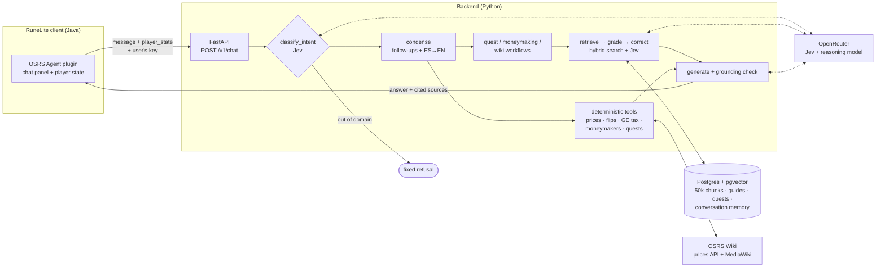

# OSRS Agent

**A closed-domain AI assistant for Old School RuneScape that lives inside the game client. A RuneLite plugin (Java) talks to a Python backend (FastAPI + LangGraph) that answers with Corrective RAG over 50k chunks of the OSRS Wiki, computes prices, flips and money-making methods with deterministic code instead of the LLM, and personalizes every answer with the player's live character state.**


> *"What do I need to start Monkey Madness II?"*, then *"¿y si no tengo el m'speak amulet?"*: the agent resolves the follow-up from the conversation, answers in Spanish from English wiki pages, checks the player's finished quests and skill levels, and cites the pages it used.

## Results

Every number below comes from a reproducible benchmark in [`backend/eval/`](backend/eval/), with a **held-out set** written after tuning and never used to change anything.

| What | Result |
|---|---|
| **End-to-end eval** (real graph, models, DB and tools) | **45/46** dev cases · **12/13** held-out |
| Intent router accuracy | **46/46**, English 28/28 and Spanish 18/18 |
| Answer-bearing passage survives relevance filtering | **21/21** |
| Made-up answers to unanswerable questions | **0**; "no evidence" given correctly 5/6 times, never when an answer existed |
| **Retrieval hit@5**, held-out set | **58% → 88%** (dev: 67% → 92%) after chunking and template-rendering fixes |
| Retrieval MRR, held-out set | 0.41 → 0.63 |
| Money-making valuations vs the Wiki's own figures | median ratio **1.000** over 102 guides, 101 within ±10% |
| **Cost per question** | **≈ $0.0006**, about 1,600 questions per dollar |
| Latency | median 5.4 s · p95 12.6 s |
| Index | 17,561 wiki pages → 50,555 chunks, plus 637 parsed money-making guides and 220 structured quests |
| Tests | 769 Python tests offline + 50 Java plugin tests |

### Engineering highlights

- **Retrieval quality came from the data, not the model.** Auditing real chunks showed the index was *losing content*: 2,122 wiki templates were dropped or guessed, including drop tables, clue solutions (761 pages), multi-form infoboxes (~600 pages) and boss strategy pages (113). Chunk headers also misreported their section. Fixing rendering and chunking alone took held-out hit@5 from 58% to 83% with the *same* embedder; switching embedders added the last 5 points. ([rag-quality.md](docs/rag-quality.md))
- **Derived data the wiki doesn't store.** "Which monsters drop a dragon pickaxe?" has no answer in the wikitext, because the wiki computes that table at render time. Ingestion inverts every monster's drop table into 21,552 "Drop sources" rows across 2,874 item pages.
- **Hybrid retrieval.** pgvector similarity + weighted full-text search (title and section headers weigh more) + a title list that pulls in a named boss's `/Strategies` page, fused with Reciprocal Rank Fusion.
- **Corrective RAG with calibrated decisions.** A decision model (TypeSafe's Jev via OpenRouter) returns *probabilities*, not text, for routing, per-passage relevance and answer sufficiency, all in one call per round (~$0.0004). Thresholds were tuned with offline sweeps over saved runs. When evidence is insufficient, the graph rewrites the query and searches again, then falls back to the live wiki API. If it still finds nothing, it says so instead of guessing.
- **The LLM never does arithmetic.** Grand Exchange tax, flip margins, buy limits, money-making GP/hour (with live prices, market liquidity caps and requirement checks against the player's stats) are all deterministic Python tools with hand-computed tests. After generation, a grounding pass looks up every large number in the answer (`1.5M`, `300k`, `1.500.000`…) in the tool results, wiki passages and player message. If a number has no source, the model rewrites the answer, and if it still has none, the sentence is dropped.
- **Bring-your-own-key, safely.** The user's OpenRouter key travels per request in a header and is never persisted or logged. A redaction filter and tests assert it never appears in any log line.
- **Bilingual.** Spanish questions are condensed into standalone English queries before retrieval, and answers come back in the user's language.

## Architecture



Design principles, from the [spec](SPEC.md):

1. Numbers are computed by code, never by the LLM.
2. The decision model decides (routing, grading); the LLM reasons and writes.
3. No evidence means no answer, not an invented one.
4. Informational only: the agent never automates in-game actions.
5. The user's key is a secret: pass-through per request, never stored.

## Stack

| Layer | Choice |
|---|---|
| Game client | RuneLite plugin, Java 11, Gradle, Guice; 50 tests including the full plugin ↔ backend flow |
| API | FastAPI, typed errors, loopback-only by default |
| Orchestration | LangGraph with a Postgres checkpointer for per-thread memory and retention pruning |
| Decisions | `typesafe/jev-1.13` (OpenRouter Decisions API): Choice / Yes-No / Score probabilities |
| Generation | `deepseek/deepseek-v4-flash` via OpenRouter, configurable |
| Embeddings | `Snowflake/snowflake-arctic-embed-s`, local (33M params, 384 dims) |
| Storage | Postgres + pgvector, SQL migrations under [`supabase/migrations/`](supabase/migrations/) |
| Data | OSRS Wiki via MediaWiki API (CC BY-NC-SA 3.0) + real-time prices API |
| Tooling | `uv`, `pytest`, `ruff`, `make` |

## Quickstart

Requires [`uv`](https://docs.astral.sh/uv/), Python 3.12, Postgres with pgvector, and Java 11+ for the plugin.

```bash
cd backend
uv sync
cp .env.example .env                 # set PRICES_USER_AGENT (contact) and SUPABASE_DB_URL

uv run pytest                        # offline tests (HTTP mocked)
uv run python -m scripts.migrate     # apply the schema

# Build the index locally: no API key needed, embeddings run on-device
uv run python -m scripts.ingest fetch --scope v0     # download the wiki (~2 min)
uv run python -m scripts.ingest load  --scope v0     # parse, chunk, embed, load (~11-14 min)

uv run python -m app.main            # API on http://127.0.0.1:8000
```

From the repository root, the `Makefile` wraps the common flows:

```bash
make backend      # Postgres + API
make plugin       # RuneLite in developer mode with the plugin loaded
make play         # everything at once; shuts down what it started on exit
make test         # all Python + Java tests
make retrieval    # retrieval benchmark: seconds, no LLM, no key
```

Talk to the agent from the terminal (uses `OPEN_ROUTER_KEY` from `.env`):

```bash
uv run python -m scripts.chat --profile main_midgame \
    --say "What do I need to start Monkey Madness II?" \
    --say "¿y si no tengo el m'speak amulet?"
```

### Reproducing the numbers

```bash
cd backend
uv run python -m eval.retrieval_bench                              # retrieval, dev set (free)
uv run python -m eval.retrieval_bench --cases eval/retrieval_heldout.yaml
uv run python -m eval.run_eval                                     # end-to-end, 46 cases (≈ $0.03)
uv run python -m eval.run_eval --cases eval/heldout.yaml           # held-out, 13 cases
uv run python -m eval.run_eval --sweep data/eval/run-<date>.json   # re-tune thresholds offline
```

## Repository layout

```
backend/app/
  graph/        LangGraph state, router, condensation, CRAG loop, workflows, grounding, formatting
  rag/          local embeddings, hybrid retrieval + RRF, title lookup, Jev grading, live wiki search
  ingest/       wikitext → text renderer, guide and quest parsers, drop-source inversion, chunking, loading
  tools/        GE tax, item resolution, prices, history, flips, flip analytics, moneymakers, quests
  clients/      OpenRouter (per-request key), Jev Decisions API, wiki prices, MediaWiki
  api/ main.py  FastAPI contract and app; security.py redacts secrets from every log record
backend/eval/   end-to-end and retrieval benchmarks with dev and held-out sets
backend/tests/  769 offline tests; `-m live` runs the ones that hit real services
plugin/         RuneLite plugin (Java, Gradle, official template)
supabase/       SQL migrations: documents, guides, quests, judgments, index metadata
docs/           per-milestone design notes and acceptance criteria (in Spanish)
```

## Engineering notes

Each milestone has a written design and acceptance report, with measurements and the failures that shaped it. The notes are in Spanish:

| Doc | Covers |
|---|---|
| [rag-quality.md](docs/rag-quality.md) | Index audit, template rendering, chunking, embedder choice, retrieval benchmark |
| [eval-m8.md](docs/eval-m8.md) | End-to-end eval, threshold sweeps, what manual review of answers found |
| [eval-m4.md](docs/eval-m4.md) | Hybrid retrieval and Jev grading: separating answerable from unanswerable |
| [graph-m5.md](docs/graph-m5.md) | Graph design, follow-up condensation, CRAG loop, memory |
| [api-m6.md](docs/api-m6.md) | HTTP contract, typed errors, key redaction |
| [moneymakers.md](docs/moneymakers.md) | Money-making valuation rules and validation against the wiki |
| [flipping.md](docs/flipping.md) | Flip ranking with price-history analytics |
| [verification.md](docs/verification.md) | Every spec assumption checked against current documentation |

## Status

Milestones 1-8 are done: clients, deterministic tools, ingestion, hybrid retrieval and grading, the full graph, the HTTP API, the plugin and the evaluation. The plugin has been verified loading in a real RuneLite client. End-to-end use in a logged-in game session is the remaining manual check ([guide](docs/probar-el-plugin.md)).

## License and attribution

Wiki content is © the OSRS Wiki contributors under [CC BY-NC-SA 3.0](https://creativecommons.org/licenses/by-nc-sa/3.0/), so this is a **non-commercial** project. Every answer cites the wiki pages it used. See [`NOTICE`](NOTICE). Old School RuneScape is a trademark of Jagex Ltd.; this project is not affiliated with Jagex or RuneLite.
